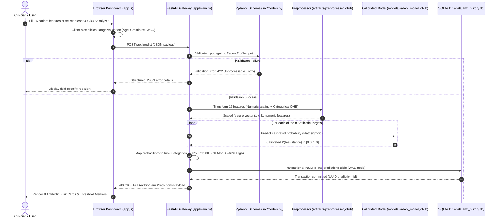
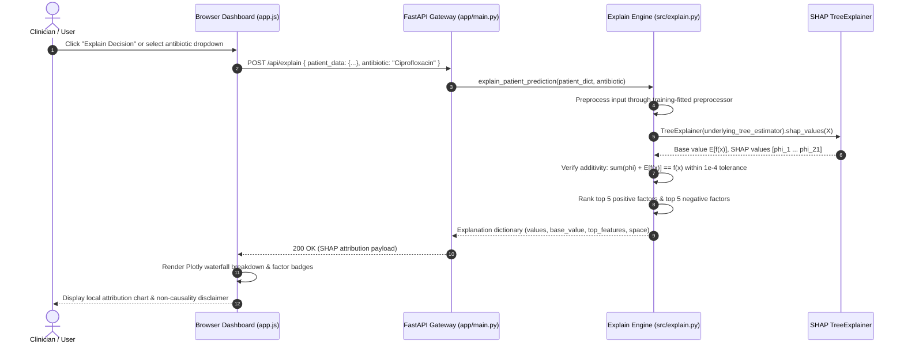

# AMR-X Technical Architecture Specification

**System Version:** 1.0.0-prototype  
**Classification:** Research Prototype (Synthetic Data Decision Support)  
**Live Showcase Prototype:** [https://amr-chi.vercel.app/](https://amr-chi.vercel.app/)

---

## 1. System Overview

AMR-X (formerly AMR-Predict) is a clinical decision-support research prototype designed to estimate antimicrobial resistance (AMR) probabilities across 8 key therapeutic antibiotics using 16 patient demographic, laboratory, microbiological, and clinical exposure features.

The platform pairs a high-performance Python FastAPI backend with an institutional, accessible frontend dashboard. It features strict train/test data leakage isolation, automated model selection between Random Forest and XGBoost, holdout probability calibration (Platt/Sigmoid scaling), SHAP TreeExplainer local and global attributions, crash-safe SQLite transactional persistence (WAL mode), and ReportLab automated PDF clinical antibiogram generation.

> [!WARNING]
> **Research Prototype Disclaimer:** AMR-X is trained on synthetic data (`amr_synthetic_dataset.csv`, $N=20,000$). It is an educational and algorithmic research prototype. It has **NOT** been clinically validated, is **NOT** a medical device, and must **NOT** be used for clinical diagnosis, treatment prescribing, or dosage guidance. Standard laboratory antimicrobial susceptibility testing (AST) remains clinically mandatory.

---

## 2. Architecture Diagram

```mermaid
flowchart TD
    subgraph Client["Clinical Presentation Tier (Browser)"]
        UI["Clinical Intelligence Dashboard (Vanilla HTML5 / CSS3 / ES6)"]
        Forms["Patient Profile Input Form (16 Features & Clinical Presets)"]
        Visuals["Visualization Engine (Chart.js & Plotly.js)"]
        ReportModal["Antibiogram Modal & PDF Exporter"]
    end

    subgraph Gateway["API Gateway Tier (FastAPI)"]
        Router["FastAPI Application (app/main.py)"]
        Validator["Pydantic v2 Schema Validation (PatientProfileInput)"]
        CORS["CORS Middleware & Exception Handlers"]
        StaticSrv["Static File Server (HTML/CSS/JS)"]
    end

    subgraph MLEngine["ML Inference & Calibration Tier"]
        Preproc["Preprocessor Pipeline (StandardScaler + OneHotEncoder)"]
        ModelTourney["Model Registry (4 Random Forest + 4 XGBoost)"]
        Calibrator["Platt Sigmoid Calibrators (Holdout-Fitted N=2,400)"]
        RiskMapper["Risk Band Categorizer (<30% Low, 30-59% Mod, >=60% High)"]
    end

    subgraph XAIEngine["Explainable AI Tier (SHAP)"]
        TreeExpl["SHAP TreeExplainer"]
        WaterfallGen["Local Attribution Decomposition (f(x) = E[f(x)] + sum(phi))"]
        GlobalGen["Global Dataset Feature Importance Aggregator"]
    end

    subgraph Storage["Data Persistence & Document Tier"]
        DB["SQLite Database Engine (WAL Mode, Parameterized)"]
        PDF["ReportLab PDF Generation Engine (/api/reports/{id}/pdf)"]
    end

    Forms -->|HTTP POST /api/predict| Validator
    Validator --> Router
    Router --> Preproc
    Preproc --> ModelTourney
    ModelTourney --> Calibrator
    Calibrator --> RiskMapper
    RiskMapper --> Router
    Router -->|JSON Antibiogram Response| UI

    UI -->|HTTP POST /api/explain| Router
    Router --> TreeExpl
    TreeExpl --> WaterfallGen
    WaterfallGen --> Visuals

    Router -->|Transactional Insert| DB
    Router -->|Query Historical Records| DB
    DB --> UI

    UI -->|HTTP GET /api/reports/{id}/pdf| Router
    Router --> PDF
    PDF -->|Streaming PDF Binary| ReportModal
```

---

## 3. End-to-End Request Lifecycle

### A. Inference & Prediction Request (`POST /api/predict`)



### B. Explainable AI Request (`POST /api/explain`)



---

## 4. Component Details

### 4.1 Client Presentation Tier
- **Technology:** Vanilla JavaScript (ES6+), HTML5, CSS3, Chart.js 4.4, Plotly.js 2.29.
- **Design Principles:** White/light clean clinical aesthetic (`#F8FAFC` background, `#FFFFFF` cards, `#E2E8F0` borders, `#0F172A` deep navy typography, `#0D9488` restrained teal accents).
- **Client-Side Validation:** Validates physical and physiological boundaries (Age: 18–110, Creatinine: 0.1–25.0 mg/dL, WBC: 0.1–100.0 k/µL, Prior UTIs: 0–50).
- **Responsiveness:** Desktop and mobile responsive layouts, collapsible sidebar, non-blocking asynchronous fetch calls.

### 4.2 API Gateway & Controller Tier
- **Technology:** FastAPI 0.110+, Pydantic v2, Uvicorn ASGI server.
- **Validation Pipeline:** Rejects unphysiological values, negative lab results, unrecognized pathogens, and unknown infection types before hitting the ML pipeline.
- **Error Handling:** Standardized error responses (`{"detail": "...", "status_code": ...}`) without leaking stack traces or internal file system paths.
- **CORS Management:** Configured for cross-origin resource sharing, permitting secure local and web-based frontend access.

### 4.3 Machine Learning Inference Tier
- **Libraries:** Scikit-Learn 1.4+, XGBoost 2.0+, Joblib.
- **Feature Pipeline:**
  - Scaler: `StandardScaler` (fitted exclusively on training split $N=11,200$).
  - Encoder: `OneHotEncoder(handle_unknown='ignore', sparse_output=False)` for `organism`, `infection_type`, and `sex`.
  - Strict leakage isolation: zero test data or target-derived columns (`patient_id`, `*_resistance_probability`) ever enter the transformer.
- **Estimator Tournament:**
  - Evaluates both **Random Forest** (100–150 estimators, balanced class weights) and **XGBoost** (`scale_pos_weight`, tree depth 3–5).
  - Selects the superior model on the validation split ($N=2,400$) using the documented multi-metric score:
    $$\text{Selection Score} = 0.45 \times \text{ROC-AUC} + 0.35 \times \text{F1} + 0.20 \times \text{Recall}$$
- **Holdout Probability Calibration:**
  - Fits a Platt Sigmoid calibrator (`CalibratedClassifierCV(method='sigmoid', cv='prefit')`) using exclusively the dedicated holdout calibration split ($N=2,400$).
  - Never touches the final test split ($N=4,000$).

### 4.4 Explainable AI (XAI) Engine
- **Library:** SHAP (`shap.TreeExplainer`).
- **Mathematical Space Handling:**
  - For Random Forest: SHAP values represent probability shifts ($\Delta p$).
  - For XGBoost: SHAP values represent margin log-odds shifts.
- **Additivity Guarantee:** Formally verifies that $\sum \phi_i + E[f(x)] \approx f(x)$ within numerical tolerance ($1\times 10^{-4}$).
- **Attribution vs. Causation:** System output is explicitly guarded with notices clarifying that feature attributions represent statistical model contributions, not clinical microbiological mechanisms.

### 4.5 Data Persistence & Reporting Tier
- **Database Engine:** SQLite 3 with Write-Ahead Logging (`PRAGMA journal_mode=WAL`).
- **Connection Management:** Context manager (`get_db()`) ensuring transactions commit safely or rollback on exception.
- **Environment Isolation:** Database path is configurable via `AMR_DB_PATH`, enabling in-memory or temporary paths during automated pytest execution (`tests/test_backend_reliability.py`).
- **Reporting Engine:** ReportLab 4.1+ generates multi-page vector clinical PDF antibiograms with patient metadata, full 8-drug risk matrix, highest-risk callouts, and medical research disclaimers.

---

## 5. Security & Boundary Enforcement

1. **Patient Identifier Isolation:** Patient IDs are generated client-side or assigned via random UUID (`PAT-YYYYMMDD-XXXX`). No identifiable personal health information (PHI) is processed or stored.
2. **Path Traversal & Static Route Defense:** Static files are served strictly from `public/` and `app/static/` via FastAPI's `StaticFiles` middleware; arbitrary path traversal outside workspace roots is denied.
3. **Database Injection Defense:** All SQLite queries utilize parameterized bindings (`?`); string concatenation in SQL queries is strictly prohibited.
4. **Error Masking:** Unexpected runtime exceptions are caught by global exception handlers, returning RFC 7807-style error payloads without dumping Python tracebacks or environment variables.
